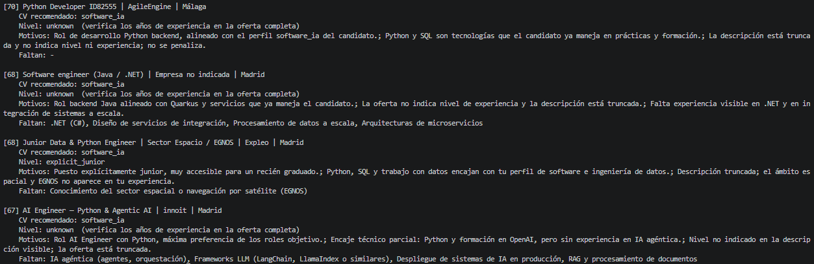
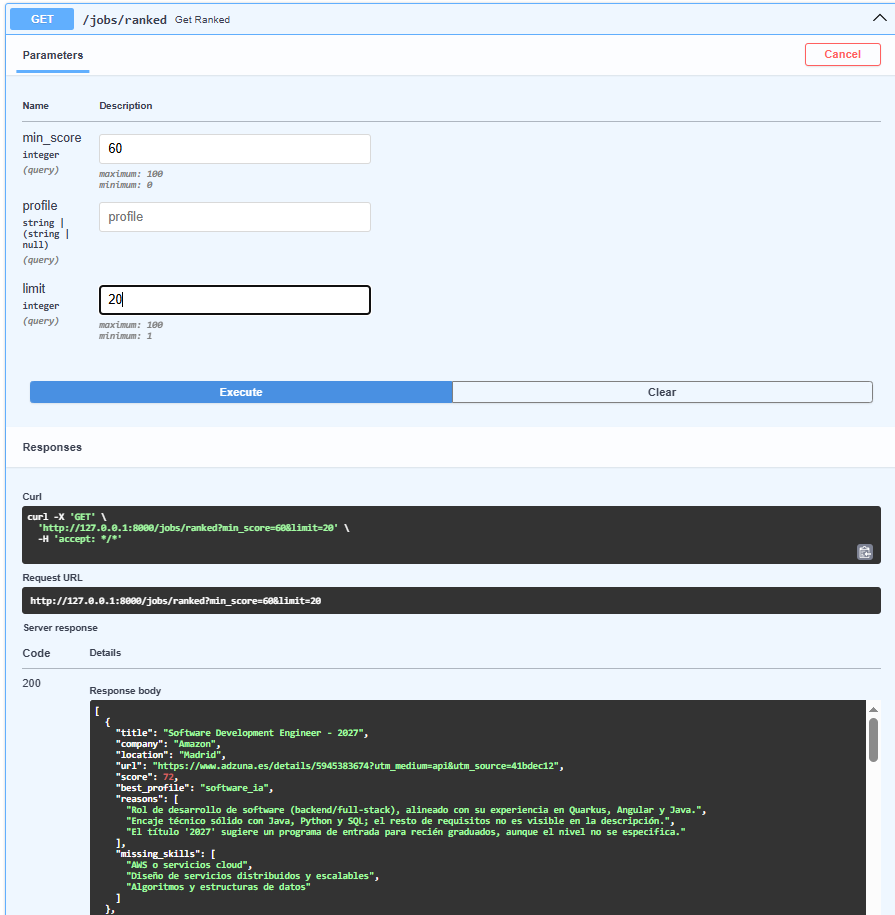

# Job Search Assistant

Asistente de búsqueda de empleo con IA: descarga ofertas reales, las guarda en SQLite y usa Claude para puntuarlas contra mis dos perfiles de CV, indicando qué CV conviene enviar a cada una.

*English summary: a Python pipeline that fetches job postings from the Adzuna API, stores them in SQLite, scores them against two CV profiles with Claude (validated JSON output via Pydantic) and exposes the ranking through a FastAPI service.*



## Qué problema resuelve

Buscar trabajo junior en tecnología implica leer decenas de ofertas, y muchas no encajan: piden años de experiencia, son de otro sector o ya han caducado. Este proyecto automatiza el primer filtro:

1. Descarga ofertas recientes (últimos 7 días) de las ciudades que me interesan.
2. Descarta con reglas baratas las claramente senior, sin gastar llamadas al LLM.
3. Puntúa el resto de 0 a 100 con Claude, elige el CV más adecuado y explica el porqué.
4. Muestra cuánta evidencia hay sobre el nivel de la oferta, para saber cuáles verificar a mano.

## Arquitectura

```
Adzuna API ──► sources/adzuna.py ──► JobPosting (Pydantic) ──► SQLite (jobs)
                                                                   │
              reglas (título senior, años de experiencia) ◄────────┤
                                                                   ▼
                          Claude (scoring/scorer.py) ──► JobScore (Pydantic) ──► SQLite (scores)
                                                                                      │
                                                          CLI  ◄──────────────────────┤
                                                          FastAPI (/jobs/ranked) ◄────┘
```

Decisiones de diseño:

- **Modelo común `JobPosting`.** Cada fuente convierte su JSON a este modelo, así que añadir otra fuente no toca el resto del sistema.
- **Salida estructurada y validada.** El LLM responde en JSON y Pydantic lo valida (rangos, valores permitidos, longitudes). Si el JSON es inválido, se reintenta una vez.
- **Reglas antes que LLM.** Un filtro por título y por años de experiencia exigidos evita pagar por ofertas obviamente fuera de rango.
- **Defensa ante prompt injection.** El texto de la oferta se trata como dato no confiable en el prompt.
- **Consultas SQL parametrizadas** y `UNIQUE (source, external_id)` para no duplicar ofertas.
- **Tests sin red.** Los tests usan fixtures guardadas y bases de datos en memoria, sin llamar a ninguna API.

## Tecnologías

Python 3.10+, `requests`, Pydantic, SQLite, API de Anthropic (Claude), FastAPI, pytest, Git/GitHub.

## Instalación

```bash
git clone https://github.com/raulgs13-afk/job-search-assistant.git
cd job-search-assistant
python -m venv .venv
.venv\Scripts\activate          # Windows (en Mac/Linux: source .venv/bin/activate)
pip install -e .
```

Copia `.env.example` a `.env` y rellena tus claves:

```
ADZUNA_APP_ID=
ADZUNA_APP_KEY=
ANTHROPIC_API_KEY=
SCORING_MODEL=claude-haiku-5-5
```

Los CVs (en Markdown) van en `data/cvs/`, uno por perfil (por ejemplo `software_ia.md` y `biomedica_consultoria.md`). Esa carpeta está en `.gitignore`; el nombre de cada archivo es el nombre del perfil que verá el modelo.

## Uso

```bash
# Descargar ofertas y listarlas
python -m jobassistant.cli --query "junior python"

# Puntuar las ofertas pendientes y ver el ranking
python -m jobassistant.cli --no-fetch --score --limit 20

# Volver a puntuar todo (por ejemplo tras cambiar el prompt)
python -m jobassistant.cli --no-fetch --score --rescore --limit 40

# Servidor de la API
uvicorn jobassistant.api.main:app --reload
```

La documentación interactiva está en `http://127.0.0.1:8000/docs`.



| Endpoint | Descripción |
|---|---|
| `GET /health` | Estado del servicio |
| `GET /jobs` | Ofertas guardadas, con filtro por ubicación |
| `GET /jobs/ranked?min_score=60&profile=software_ia` | Ranking con puntuación, motivos, skills que faltan y nivel detectado |

## Evaluación

Para no fiarme de la intuición, etiqueté a mano un conjunto de ofertas (`alta`, `media` o `baja`) leyendo la oferta completa en la web, **sin mirar antes las puntuaciones del modelo**, y comparé. El script es `scripts/evaluate.py`, y cada ejecución se registra en `data/eval_history.jsonl`.

<!-- Rellena esta tabla con tus ejecuciones reales de data/eval_history.jsonl -->

| Fecha | Versión del prompt | Casos | Aciertos exactos | Errores graves | Orden alta > baja |
|---|---|---|---|---|---|
| 2026-11-04 | v2: roles objetivo | 18 | 8/18 (44%) | 3 | 85% |
| 2026-11-04 | v2, sin ofertas caducadas | 11 | 5/11 (45%) | 4 | 75% |
| 2026-11-05 | v2 + `level_evidence` | 15 | 7/15 (47%) | 4 | 72% |

Los conjuntos de casos cambiaron entre ejecuciones (se retiraron ofertas caducadas y se añadieron nuevas), por lo que las filas no son comparables. En la última, los 4 errores graves tenían nivel `unknown`: la información que habría permitido acertar estaba fuera del texto truncado.

**Hallazgo principal:** en la última ejecución, los 4 errores graves tenían nivel `unknown`. El modelo no se equivocaba con seguridad: la información que habría permitido acertar (por ejemplo, "4 años de experiencia") estaba fuera de los ~500 caracteres que devuelve la API de Adzuna. Por eso el sistema devuelve un campo `level_evidence` y el CLI avisa de que hay que verificar los años en la oferta completa.

Detalles del método:

- Las ofertas caducadas se excluyeron del conjunto por no poder etiquetarse con criterio.
- La idea de `level_evidence` surgió **después** de ver los resultados de una ronda anterior, así que no es una mejora validada de forma independiente.
- El conjunto es pequeño y los scores del LLM varían unos puntos entre ejecuciones: los resultados son orientativos.

## Limitaciones conocidas

- **Descripciones truncadas.** La API de búsqueda de Adzuna devuelve solo un fragmento. Los requisitos de experiencia pueden quedar fuera.
- **Ofertas caducadas.** La base de datos no detecta cuándo una oferta deja de estar disponible.
- **Puntuaciones aproximadas.** Úsalas por bloques (65 o más: mirar; 50-64: dudosa; menos de 50: descartar), no como un orden exacto.
- **Heurística de años de experiencia.** La regla basada en expresiones regulares puede descartar de más (por ejemplo, "valorable 3 años").
- **Plan de pruebas de Adzuna.** El acceso gratuito es de unas pocas llamadas de prueba, por lo que el proyecto reutiliza las ofertas guardadas.
- **La API no tiene autenticación.** Está pensada para ejecutarse en local, no para exponerse en internet.

## Estructura del proyecto

```
src/jobassistant/
├── models.py          # JobSearch, JobPosting, JobScore
├── sources/adzuna.py  # cliente de Adzuna y parser
├── db/                # esquema SQLite y repositorio
├── scoring/scorer.py  # prompt, llamada a Claude y validación
├── api/main.py        # FastAPI
└── cli.py             # fetch -> guardar -> puntuar -> ranking
scripts/               # exportación y evaluación
tests/                 # tests y casos etiquetados
```

## Tests

```bash
python -m pytest -v
```

## Próximos pasos

- [ ] Segunda fuente de ofertas con descripción completa
- [ ] Detectar ofertas caducadas (`last_seen_at`)
- [ ] Conjunto de validación separado para el prompt
- [ ] Dockerfile y GitHub Actions con `pytest`
- [ ] Autenticación y `POST /search` en la API
